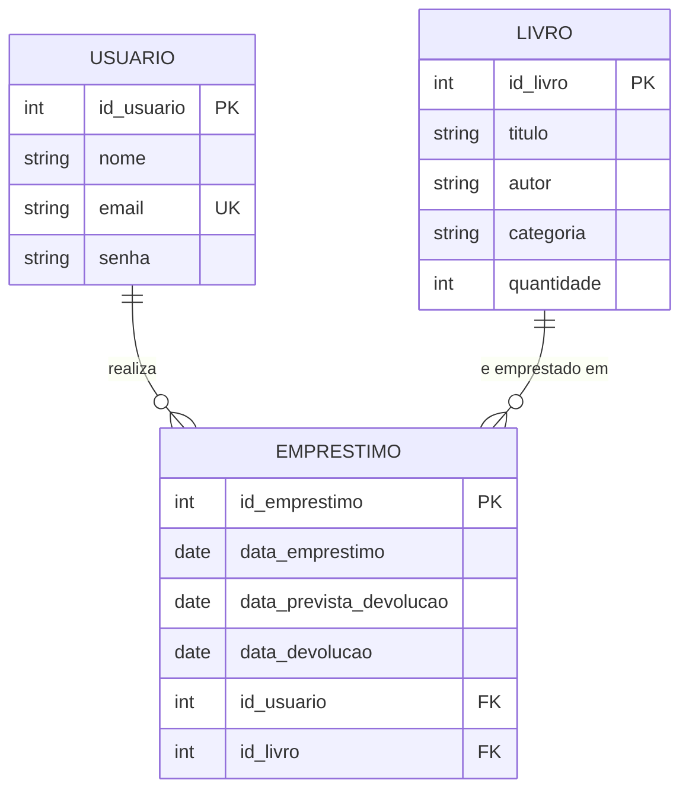

# Diagrama Entidade Relacionamento (DER)

Sistema: Biblioteca Escolar

## Diagrama

Para gerar a imagem, cole o bloco abaixo em https://mermaid.live e exporte em PNG ou SVG.

## Entidades e atributos

### Usuario

| Atributo | Tipo | Restrição | Descrição |
| --- | --- | --- | --- |
| id_usuario | inteiro | chave primária | Identificador do usuário |
| nome | texto | obrigatório | Nome completo |
| email | texto | obrigatório, único | Usado no login |
| senha | texto | obrigatório | Armazenada como hash, nunca em texto puro |

### Livro

| Atributo | Tipo | Restrição | Descrição |
| --- | --- | --- | --- |
| id_livro | inteiro | chave primária | Identificador do livro |
| titulo | texto | obrigatório | Título da obra |
| autor | texto | obrigatório | Autor da obra |
| categoria | texto | obrigatório | Gênero ou área do livro |
| quantidade | inteiro | obrigatório, maior ou igual a 0 | Exemplares disponíveis no momento |

### Emprestimo

| Atributo | Tipo | Restrição | Descrição |
| --- | --- | --- | --- |
| id_emprestimo | inteiro | chave primária | Identificador do empréstimo |
| data_emprestimo | data | obrigatório | Dia em que o livro foi retirado |
| data_prevista_devolucao | data | obrigatório | Prazo combinado para devolver |
| data_devolucao | data | opcional | Preenchida somente quando o livro é devolvido |
| id_usuario | inteiro | chave estrangeira | Quem pegou o livro |
| id_livro | inteiro | chave estrangeira | Qual livro foi emprestado |

## Relacionamentos

| Relacionamento | Cardinalidade | Leitura |
| --- | --- | --- |
| Usuario realiza Emprestimo | 1 para N | Um usuário pode ter vários empréstimos, e cada empréstimo pertence a um único usuário. |
| Livro é emprestado em Emprestimo | 1 para N | Um livro pode aparecer em vários empréstimos ao longo do tempo, e cada empréstimo se refere a um único livro. |

## Observação sobre o modelo

Além dos atributos exigidos no enunciado, foi acrescentado `data_prevista_devolucao` em Emprestimo, porque a tela de gestão de empréstimos pede o prazo previsto e `data_devolucao` só passa a existir quando a devolução acontece.
